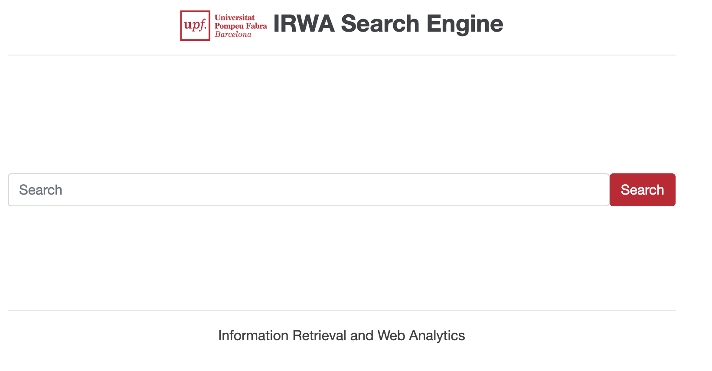

# Information Retrieval and Web Analytics (IRWA) - Final Project 2026

<table>
  <tr>
    <td style="vertical-align: top;">
      
    </td>
    <td style="vertical-align: top;">
      This repository contains our group's code for the IRWA Final Project - a RAG system on top of a custom search engine with web analytics (built from the course template).
      The project is implemented using Python and the Flask web framework. It includes a simple web application that allows users to search through a collection of documents and view analytics about their searches.
    </td>
  </tr>
</table>

----
## Project Structure

```
/riaw-search-engine
├── myapp                # Contains the main application logic
├── templates            # Contains HTML templates for the Flask application
├── static               # Contains static assets (images, CSS, JavaScript)
├── data                 # Dataset (fashion_products_dataset.json, validation_labels.csv) - git-ignored
├── project_progress     # Contains your solutions for Parts 1, 2, and 3 of the project
├── .env.example         # Copy to .env (git-ignored) and fill in secrets such as the Groq API key
├── .gitignore           # Specifies files and directories to be ignored by Git
├── LICENSE              # License information for the project
├── requirements.txt     # Lists Python package dependencies
├── web_app.py           # Main Flask application
└── README.md            # Project documentation and usage instructions
```


----
## To download this repo locally

Open a terminal console and execute:
```
cd <your preferred projects root directory>
git clone https://github.com/asteraceae/riaw-search-engine.git
cd riaw-search-engine
cp .env.example .env   # then edit .env (Groq API key etc.); never commit it
```

## Setting up the Python environment (only for the first time you run the project)
### Install virtualenv
Setting up a virtualenv is recommended to isolate the project dependencies from other Python projects on your machine.
It allows you to manage packages on a per-project basis, avoiding potential conflicts between different projects.

In the project root directory execute:
```bash
pip3 install virtualenv
virtualenv --version
```

### Prepare virtualenv for the project
In the root of the project folder run to create a virtualenv named `irwa_venv`:
```bash
virtualenv irwa_venv
```

If you list the contents of the project root directory, you will see that it has created a new folder named `irwa_venv` that contains the virtualenv:
```bash
ls -l
```

The next step is to activate your new virtualenv for the project:
```bash
source irwa_venv/bin/activate
```

or for Windows...
```cmd
irwa_venv\Scripts\activate.bat
```

This will load the python virtualenv for the project.

### Installing Flask and other packages in your virtualenv
Make sure you are in the root of the project folder and that your virtualenv is activated (you should see `(irwa_venv)` in your terminal prompt).
And then install all the packages listed in `requirements.txt` with:
```bash
pip install -r requirements.txt
```

If you need to add more packages in the future, you can install them with pip and then update `requirements.txt` with:
```bash
pip freeze > requirements.txt
```

Enjoy!


## Starting the Web App
```bash
python -V
# Make sure we use Python 3

python web_app.py
```
The above will start a web server with the application:
```
 * Serving Flask app 'web-app' (lazy loading)
 * Environment: production
   WARNING: This is a development server. Do not use it in a production deployment.
   Use a production WSGI server instead.
 * Debug mode: off
 * Running on http://127.0.0.1:8088/ (Press CTRL+C to quit)
```

Open Web app in your Browser:  
[http://127.0.0.1:8088/](http://127.0.0.1:8088/) or [http://localhost:8088/](http://localhost:8088/)


## Usage: 
0. Put the data file `fashion_products_dataset.json` in the `data` folder. It will be provided to you by the instructor.
1. As for Parts 1, 2, and 3 of the project, please use the `project_progress` folder to store your solutions. Each part should contain `.pdf` file with your report and `.ipynb` (Jupyter Notebook) file with your code for solution and `README.md` with explanation of the content and instructions for results reproduction.
2. For the Part 4, of the project, you should build a web application using Flask that allows users to search through a collection of documents and view analytics about their searches. You should work mailnly in the `web_app.py` file `myapp` and `templates` folders. Feel free to change any code or add new files as needed. The provided code is just a starting point to help you get started quickly.
3. Make sure to update the `.env` file with your Groq API key (can be found [here](https://groq.com/), the free version is more than enough for our purposes) and any other necessary configurations. IMPORTANT: Do not share your `.env` file publicly as it contains sensitive information. It is included in `.gitignore` to prevent accidental commits. (It should never be included in the repos and appear here only for demonstration purposes).
4. Have fun and be creative!

## Delivery checklist (per part)
- Report PDF named `IRWA-2026-uXXXXXX-uXXXXXX-uXXXXXX-part-N.pdf` (include GitHub URL + tag, assumptions, decisions, AI-usage acknowledgement).
- Git tag `IRWA-2026-part-N` pushed **before** the deadline (23:59). The brief writes `IRWA-2025-part-N`; confirm the exact string with the instructor.
- Documented code and a README with step-by-step run instructions.

| Part | Topic | Deadline |
|------|-------|----------|
| 1 | Text processing and EDA | 23/10/2026 |
| 2 | Indexing and evaluation | 30/10/2026 |
| 3 | Ranking and filtering | 20/11/2026 |
| 4 | RAG, UI and web analytics | 29/11/2026 |

## Attribution:
The project is adapted from the following sources:
- [IRWA Template 2026](https://github.com/trokhymovych/irwa-search-engine)
- [IRWA Template 2021](https://github.com/irwa-labs/search-engine-web-app)
